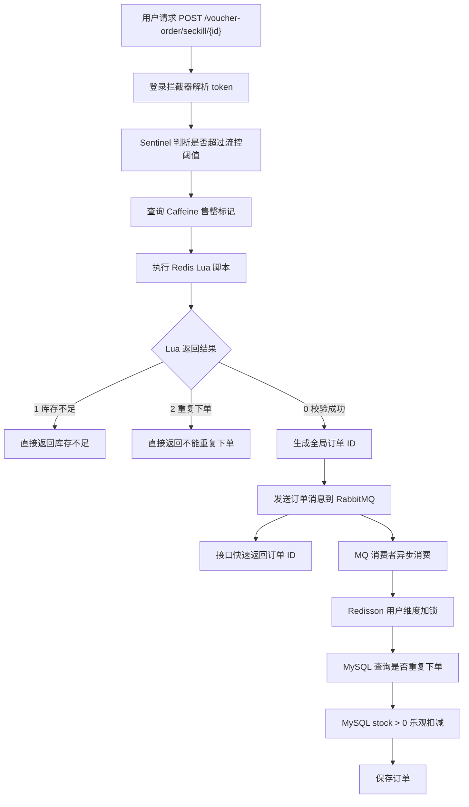

# 黑马点评高并发秒杀系统项目说明书

生成日期：2026-06-17  
项目路径：F:\XM\hm-dianping

## 1. 项目简介

本项目基于黑马点评业务场景进行二次优化，围绕本地生活点评、商铺浏览、达人探店、优惠券秒杀、关注关系、签到、AI 客服与附近推荐等功能展开。项目后端使用 Spring Boot 构建 REST API，使用 MySQL 存储核心业务数据，使用 Redis 承担登录态、缓存、地理位置、点赞、签到、秒杀库存预扣减等高频访问场景，并引入 RabbitMQ 对秒杀订单进行异步削峰落库。

本项目的核心优化方向是优惠券秒杀链路。针对高并发下容易出现的库存超卖、重复下单、数据库压力过大和请求峰值冲击等问题，项目使用 Redis Lua 脚本在 Redis 内原子完成库存判断、一人一单判断和库存预扣减，再通过 RabbitMQ 异步投递订单消息，由消费者完成 MySQL 落库。同时使用 Redisson 分布式锁、MySQL 唯一索引和数据库乐观扣减作为兜底，保证最终订单数据正确。

项目还补充了 Sentinel 限流保护、Caffeine 本地缓存、Canal binlog 同步 Redis 的预留能力、DeepSeek 智能客服接入、高德地图 POI 周边搜索等扩展能力。其中，Canal 当前配置为可选增强项，默认关闭；AI 客服与地图推荐属于辅助功能，项目简历表达时建议把秒杀高并发链路作为主亮点。

## 2. 技术栈

| 层级 | 技术 | 作用 |
| --- | --- | --- |
| 后端框架 | Spring Boot 2.7.18 | 构建 Web 服务、管理 Bean、提供 REST API |
| Java 版本 | JDK 17 | 项目编译与运行环境 |
| ORM | MyBatis-Plus 3.5.3.1 | 简化 CRUD、分页、条件构造器 |
| 数据库 | MySQL | 存储用户、商铺、优惠券、订单、博客、关注等核心数据 |
| 缓存 | Redis | 登录 token、短信验证码、商铺缓存、秒杀库存、下单用户集合、点赞、签到、Geo 数据 |
| 消息队列 | RabbitMQ | 秒杀订单异步削峰、消费者异步落库 |
| 分布式锁 | Redisson | 消费端按用户维度防止重复创建订单 |
| 本地缓存 | Caffeine | 缓存售罄标记，减少无效 Redis 请求 |
| 限流保护 | Sentinel | 对秒杀接口进行 QPS 保护，异常时降级返回 |
| binlog 监听 | Canal Client | 可选监听 MySQL binlog，同步秒杀库存/订单信息到 Redis |
| 地图能力 | 高德 Web 服务 API | 周边 POI 搜索、附近店铺推荐 |
| AI 能力 | DeepSeek API | 智能客服自然语言回复与业务数据整合 |
| 压测工具 | JMeter 5.6.3 | 秒杀接口并发压测 |
| 容器化依赖 | Docker Desktop | 本地启动 Redis、RabbitMQ |
| 前端服务 | Nginx | 静态页面代理与访问入口 |

## 3. 核心功能

### 3.1 用户登录与会话

用户使用手机号和验证码登录。验证码存入 Redis，并增加验证码发送频率限制，避免同一手机号短时间重复请求验证码。

登录成功后，系统生成 Access Token 和 Refresh Token，并将用户基本信息写入 Redis。请求进入后端时，拦截器从请求头中读取 token，根据 Redis 中的登录态还原当前用户信息，并保存到 `UserHolder`，业务代码即可获取当前用户。

### 3.2 商铺浏览与缓存

商铺详情通过 Redis 缓存加速访问。项目封装了 `CacheClient`，支持缓存穿透处理、互斥锁缓存重建、逻辑过期等模式。当前商铺详情查询主要使用缓存穿透保护：如果数据库中不存在该商铺，会将空值短期写入 Redis，避免不存在的数据被反复打到数据库。

商铺分类列表和附近商铺查询支持分页。附近商铺优先使用 Redis GEO 按经纬度查询，若 Redis GEO 数据不足，则回退到 MySQL 查询后使用 Haversine 公式计算距离并排序。

### 3.3 探店博客与点赞

用户可以发布探店博客，系统保存博客后会将博客 ID 推送到粉丝的 Redis ZSet 收件箱中。粉丝流采用滚动分页方式读取，适合按时间倒序加载动态内容。

博客点赞使用 Redis ZSet 保存点赞用户和点赞时间，既能判断当前用户是否点赞，也能按时间顺序查询前几位点赞用户。

### 3.4 关注关系与共同关注

用户关注关系存储在 MySQL，同时将关注用户 ID 写入 Redis Set。共同关注通过 Redis Set 交集计算完成，比直接在数据库中多表查询更轻量。

### 3.5 用户签到

签到功能使用 Redis Bitmap 记录用户每月签到情况。每天签到对应一个 bit 位，统计连续签到时使用 Redis bitfield 取出本月截至当前日期的签到位图，再在 Java 中计算连续签到天数。

### 3.6 优惠券秒杀

优惠券秒杀是项目核心亮点。请求进入秒杀接口后，不直接访问 MySQL，而是先执行 Redis Lua 脚本。Lua 脚本在 Redis 内一次性完成：

1. 判断秒杀库存是否充足。
2. 判断当前用户是否已经下过单。
3. 扣减 Redis 库存。
4. 将用户 ID 写入下单用户 Set。

Lua 校验成功后，后端生成订单 ID，并将订单消息发送到 RabbitMQ。消费者异步消费订单消息，再进行 Redisson 分布式锁校验、数据库重复订单查询、MySQL 乐观扣减库存和订单保存。

该设计将高并发请求的主要判断前置到 Redis，降低 MySQL 瞬时压力，同时通过 RabbitMQ 平滑流量峰值。

### 3.7 RabbitMQ 异步削峰

秒杀订单不在请求线程内同步写入数据库，而是发送到 RabbitMQ 主队列 `seckill.queue`。消费者从该队列异步拉取订单并落库。

队列配置了死信交换机和死信队列 `seckill.dlq`，当消息处理失败且不重新入队时，可进入死信队列，便于排查异常消息。压测过程中通过 RabbitMQ 管理台观察主队列积压和死信队列情况，验证异步削峰链路是否健康。

### 3.8 Sentinel 限流保护

秒杀接口使用 `@SentinelResource` 标记为 Sentinel 资源，配置资源名为 `seckillController`。当前 QPS 阈值设置为 10000，主要用于压测极限时避免 Sentinel 过早干预。后续可按真实机器承载能力降低阈值，例如 800、1000 或 1500，使接口在流量过高时直接返回“排队中”或“系统繁忙”，保护服务不被打垮。

### 3.9 Caffeine 本地缓存

项目使用 Caffeine 缓存秒杀券售罄标记。某个 voucherId 被判断为库存不足后，会短时间写入本地缓存。后续请求在进入 Redis Lua 前先检查本地售罄标记，减少库存已售罄后的无效 Redis 请求。

### 3.10 Canal 同步 Redis 预留能力

项目中包含 Canal Client 代码，可连接 Canal Server 监听 MySQL binlog。监听 `tb_seckill_voucher` 的库存变化后同步到 Redis 的 `seckill:stock:{voucherId}`；监听 `tb_voucher_order` 的订单插入后，将 userId 写入 Redis 的 `seckill:order:{voucherId}`。

当前配置中 `canal.enabled=false`，即默认关闭。该能力适合在 Canal Server、MySQL binlog 环境完整部署后启用。简历中建议表述为“预留 Canal binlog 同步能力”或“可选引入 Canal 减少缓存不一致窗口”，不要表述成“彻底解决双写一致性”。

### 3.11 AI 客服与附近推荐

项目接入 DeepSeek API，构建了智能客服入口。客服逻辑不是单纯把问题丢给大模型，而是先通过 `CustomerServiceOrchestrator` 判断用户意图，再调用本地业务工具查询订单、优惠券库存、店铺、附近推荐等数据，最后交给大模型组织自然语言回复。若 DeepSeek API Key 未配置或调用失败，会使用本地兜底回复。

附近推荐支持高德 Web 服务 API。系统可根据用户坐标、半径和关键词查询周边 POI，并将结果缓存到 Redis，减少重复调用外部接口。

## 4. 秒杀链路设计

### 4.1 请求流程



### 4.2 防超卖设计

防超卖不是只依赖一个点，而是多层保护：

1. Redis Lua 先扣 Redis 库存，保证高并发下库存判断和扣减原子执行。
2. MySQL 落库时使用 `stock = stock - 1` 且条件 `stock > 0`，保证数据库库存不会扣成负数。
3. 压测后校验订单数等于库存数，MySQL 与 Redis 库存均为 0。

### 4.3 防重复下单设计

一人一单同样做了多层兜底：

1. Redis Lua 使用 `SISMEMBER seckill:order:{voucherId} userId` 判断用户是否已下单。
2. Lua 成功后将 userId 写入 `seckill:order:{voucherId}`。
3. 消费端使用 Redisson `lock:order:{userId}` 防止同一用户并发创建订单。
4. MySQL 落库前再次查询 `user_id + voucher_id` 是否已存在。
5. 订单表增加唯一索引 `uk_user_voucher(user_id, voucher_id)`，作为最终兜底。

### 4.4 异步削峰设计

请求线程只完成 Redis 原子校验和 MQ 投递，不直接执行数据库订单写入。数据库写入由 MQ 消费者异步完成。这样能将高并发流量从“直接打 MySQL”变为“先进入 Redis 和 MQ”，提升接口响应速度，也保护数据库。

## 5. 压测结果

压测工具：JMeter 5.6.3  
压测接口：`POST http://127.0.0.1:8081/voucher-order/seckill/5`  
测试库存：100  
Token 策略：使用不同用户 token 模拟多用户同时抢券  
验证方式：压测后检查 MySQL、Redis、RabbitMQ

### 5.1 稳定压测结果

| 并发线程数 | 样本数 | 平均响应 | 中位数 | P90 | P95 | P99 | 最小值 | 最大值 | 异常率 | 吞吐量 |
| --- | ---: | ---: | ---: | ---: | ---: | ---: | ---: | ---: | ---: | ---: |
| 500 | 500 | 22ms | 8ms | 74ms | 87ms | 126ms | 4ms | 178ms | 0.00% | 408.5/sec |
| 1000 | 1000 | 13ms | 9ms | 26ms | 35ms | 76ms | 3ms | 128ms | 0.00% | 529.9/sec |
| 1500 | 1500 | 11ms | 7ms | 25ms | 37ms | 75ms | 3ms | 108ms | 0.00% | 700.6/sec |
| 2000 | 2000 | 20ms | 9ms | 58ms | 86ms | 132ms | 3ms | 251ms | 0.00% | 842.5/sec |
| 2500 | 2500 | 12ms | 10ms | 21ms | 29ms | 65ms | 4ms | 91ms | 0.00% | 893.5/sec |

其中 2500 并发是本项目当前最适合写入简历的稳定数据：

- 接口异常率：0.00%
- 吞吐量：约 893.5 TPS
- 平均响应：12ms
- P95：29ms
- P99：65ms
- 最终订单数：100
- MySQL 库存：0
- Redis 库存：0
- Redis 下单用户集合：100
- 重复下单查询结果：0 rows
- RabbitMQ 主队列：无积压
- RabbitMQ 死信队列：0

### 5.2 边界观察

3000 线程压测时，JMeter 出现约 44.27% 异常率，查看结果树显示连接 `127.0.0.1:8081` 被拒绝。说明在当前本机环境下，3000 并发已经触及服务端或本机连接承载边界。

虽然 3000 线程后 MySQL、Redis、RabbitMQ 的最终数据仍保持正确，说明一致性兜底没有失效；但由于存在连接拒绝，该组数据不建议作为“稳定性能结果”写入简历，可作为压力边界说明。

### 5.3 一人一单验证

压测后执行：

```sql
SELECT user_id, COUNT(*) c
FROM hmdp.tb_voucher_order
WHERE voucher_id = 5
GROUP BY user_id
HAVING c > 1;
```

结果为 0 rows，说明没有用户重复下单。

同时：

```sql
SELECT COUNT(*) FROM hmdp.tb_voucher_order WHERE voucher_id = 5;
```

结果为 100，说明最终订单数与库存一致。

Redis 校验：

```redis
GET seckill:stock:5
SCARD seckill:order:5
```

结果为：

```text
seckill:stock:5 = 0
seckill:order:5 = 100
```

RabbitMQ 校验：

```text
seckill.queue Ready = 0
seckill.queue Unacked = 0
seckill.dlq Total = 0
```

说明异步订单消息被正常消费，没有积压和死信。

## 6. 项目亮点

### 6.1 Redis Lua 原子秒杀校验

库存判断、一人一单判断、库存扣减和下单用户记录在同一个 Lua 脚本中完成。这样避免了多个 Redis 命令之间被其他请求插入执行的问题，保证高并发下 Redis 侧的秒杀校验是原子的。

### 6.2 RabbitMQ 异步削峰落库

秒杀请求成功后只发送订单消息，不同步写 MySQL。消费者异步落库，使请求线程快速返回，降低数据库瞬时写入压力。通过 RabbitMQ 管理台可以观察主队列积压和死信队列，便于压测和问题排查。

### 6.3 多层防超卖与防重复下单

项目不是只靠 Redis 或只靠数据库，而是使用 Redis Lua、Redisson 锁、MySQL 乐观扣减、订单唯一索引多层防护。即使某一层出现边界问题，最终仍有数据库约束兜底。

### 6.4 Redis 缓存体系

项目在商铺缓存、登录态、短信验证码、点赞、签到、关注、Geo 附近查询、秒杀库存等多个场景使用 Redis，并针对缓存穿透、缓存重建、位图签到、ZSet 排序、Set 求交集等不同数据结构进行了实践。

### 6.5 Sentinel 流控保护

秒杀接口接入 Sentinel，可在 QPS 超过阈值时快速拒绝或降级返回，避免服务被突发流量打垮。当前为了测试 TPS 上限，阈值设置较高，后续上线可根据机器承载能力调整。

### 6.6 本地缓存减少无效请求

Caffeine 缓存售罄标记，库存卖完后短时间内直接在应用内返回库存不足，减少对 Redis 的无效访问。

### 6.7 可选 Canal 缓存同步能力

项目预留 Canal Client 监听 MySQL binlog 的能力，可以在数据库库存或订单变化后同步更新 Redis，减少缓存与数据库之间的不一致窗口。该功能依赖 MySQL binlog 和 Canal Server 部署，当前默认关闭。

### 6.8 智能客服与地图增强

项目额外接入 DeepSeek 与高德 POI，用于客服问答和附近推荐展示。这部分适合作为辅助亮点，不建议盖过秒杀主链路。

## 7. 运行说明

### 7.1 启动依赖

Redis：

```powershell
docker start my-redis
```

RabbitMQ：

```powershell
docker start mq
```

RabbitMQ 管理台：

```text
http://localhost:18080
账号：admin
密码：123456
```

### 7.2 启动后端

在 IDEA 中使用 JDK 17 启动：

```text
com.hmdp.HmDianPingApplication
```

后端端口：

```text
8081
```

健康检查：

```text
http://127.0.0.1:8081/shop-type/list
```

### 7.3 启动前端

前端静态资源由 Nginx 提供：

```powershell
cd F:\nginx-1.18.0
start nginx
```

访问地址：

```text
http://localhost:8080
```

## 8. 简历推荐写法

针对优惠券秒杀场景，基于 Redis Lua 脚本原子完成库存校验、一人一单校验与库存预扣减，通过 RabbitMQ 异步削峰落库，结合 Redisson 分布式锁与 MySQL 唯一索引兜底防止重复下单，并采用 Redis 预扣库存 + MySQL 乐观扣减防止超卖。JMeter 压测 2500 并发请求下，接口异常率 0%，吞吐量约 893 TPS，平均响应 12ms，P95 29ms，P99 65ms；最终订单数与库存一致，无超卖、无重复下单，RabbitMQ 无积压和死信消息。

## 9. 后续优化建议

1. 将 Sentinel 阈值从压测用的 10000 调整为更符合机器能力的值，并区分“业务失败”和“系统失败”。
2. 增加订单消息消费失败后的补偿任务，例如扫描死信队列或落库失败记录。
3. 对 Canal 能力进行完整部署验证，包括 MySQL binlog、Canal Server、断线重连和幂等同步。
4. 统一修复源码中部分中文注释的编码问题，提升代码可读性。
5. 将压测数据整理成独立报告，保留 JMeter 截图、SQL 校验截图、RabbitMQ 队列截图，方便面试展示。

